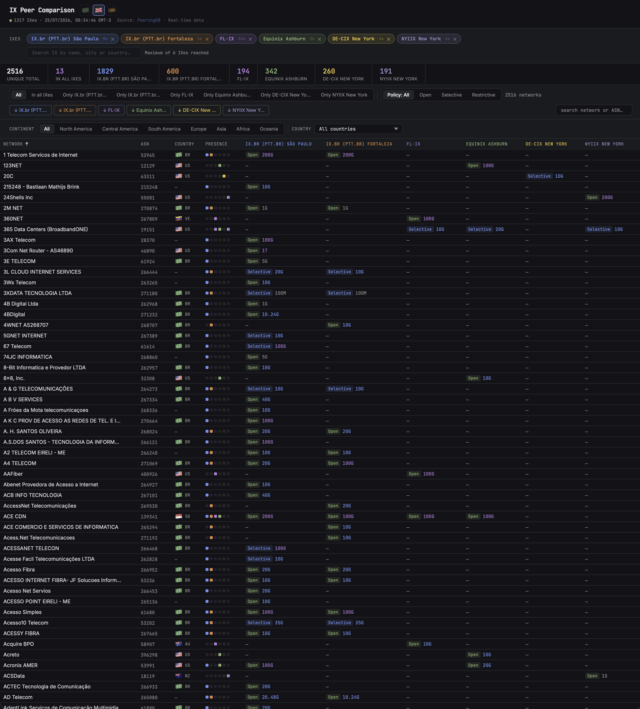

# IX Peer Comparison

A browser-based tool for visual comparison of peers across Internet Exchanges, powered by real-time data from [PeeringDB](https://www.peeringdb.com/).

Compare up to **6 IXes side by side** — see which networks are present at each exchange, filter by peering policy, continent or country, and export ASN lists.



## Features

- Search and select from a catalog of ~800 IXes worldwide
- Side-by-side comparison of up to 6 IXes simultaneously
- Real-time data via PeeringDB API — no backend, runs 100% in the browser
- Filter by presence (all IXes, exclusive to one), peering policy (Open / Selective / Restrictive), continent and country
- Search by network name or ASN
- ASN export (clipboard or .txt download)
- Caching — an IX loaded in the last 60 minutes is added again without PeeringDB requests, also after a page reload
- 3 languages: English, Português, Español
- Dark UI with progressive loading

## Usage

1. Open `index.html` in any modern browser
2. Search for an IX (e.g. "IX.br São Paulo", "DE-CIX Frankfurt", "LINX")
3. Click to add — member data loads from PeeringDB
4. Add more IXes to compare
5. Use toolbar filters to refine the view

## PeeringDB API usage

The app calls the PeeringDB API anonymously, from the browser, through a single queue:

- Loading an IX takes 1 request for its members, 1 per 1000 networks and 1 per 1000 organisations: at most 5 requests for a 2000-member IX. Requests ask only for the fields the app uses.
- Requests go one at a time, at most 18 per minute in each browser tab; the count survives a page reload.
- HTTP 429 pauses all requests for Retry-After + 2 s (32 s when the browser cannot read Retry-After; Retry-After is capped at 120 s), with a countdown in the status bar. HTTP 502/503/504, network errors, 30 s timeouts and responses that are not JSON are retried after 2, 4 and 8 s (plus up to 25 %). A request is tried at most 4 times.
- A fully loaded IX is kept in the browser (IndexedDB) for 60 minutes; adding it again in that time, also after a reload, makes no PeeringDB request. The IX catalog is kept in localStorage for 24 hours.
- If the organisations of an IX's networks cannot be loaded, the IX is still shown, without those countries, with ⚠ on its chip.

## Project Structure

```
├── index.html              # The app: one self-contained file, generated from src/ (do not edit)
├── src/
│   ├── index.html          # HTML shell; the build inlines the CSS and JS into it
│   ├── styles/app.css
│   ├── main.js             # Entry point: start-up
│   ├── actions.js          # Add/remove IX, language, filters and sort
│   ├── state.js            # Mutable app state
│   ├── config.js           # Limits, API URLs, palette, cache TTLs
│   ├── i18n/               # pt/en/es dictionaries and t()
│   ├── core/               # Pure helpers: formatting, countries, IX search, colours, retry and request batching
│   ├── data/               # localStorage, IndexedDB, PeeringDB (api.js: the request queue) and RIPEstat
│   └── ui/                 # Rendering and DOM events
├── scripts/build.mjs       # Builds index.html from src/ (esbuild)
├── tests/
│   ├── unit/               # node:test
│   ├── e2e/                # Playwright, against a fake PeeringDB/RIPEstat (tests/fake-api)
│   └── legacy/index.html   # The app before src/ existed, also run by the e2e suite
├── screenshot-1.png, screenshot-2.png
├── LICENSE                 # GNU GPLv3
├── CONTRIBUTING.md
├── CHANGELOG.md
└── README.md
```

## Development

Requires Node.js 22 or later.

```sh
npm ci
npm run build    # regenerate index.html from src/
npm run dev      # rebuild on every change under src/; reload index.html in the browser
npm run check    # lint, typecheck, unit tests, index.html sync check, Playwright tests
```

The Playwright tests need a browser: `npx playwright install chromium`, or `PW_CHANNEL=chrome npm run check` to use the installed Google Chrome.

## Contributing

Any contribution is welcome — feel free to study the code, improve it, and send suggestions.

See [CONTRIBUTING.md](CONTRIBUTING.md) for details.

## License

This project is licensed under the **GNU General Public License v3.0** — see the [LICENSE](LICENSE) file for details.

## Author

**Filho Arrais**

---

*Data provided by [PeeringDB](https://www.peeringdb.com/). This project is not affiliated with PeeringDB.*
